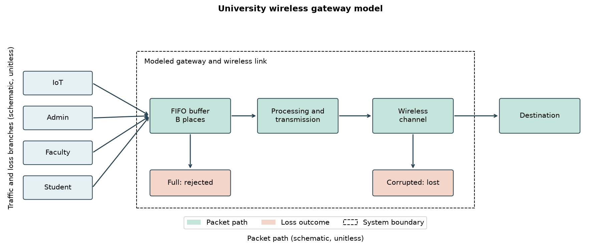

# Limited buffer capacity in a campus wireless gateway

## System definition (Task 1)

Packets are the entities. Four external sources feed one gateway, whose waiting memory and single processing and transmission unit are finite resources. Arrival, rejection, service start, service completion and channel outcome are the events. The system boundary runs from gateway admission through the wireless channel. A destination records successful packets. Inputs are the four traffic rates, service rate, waiting capacity and channel error probability. Outputs are rejected and delivered packets, delay, queue occupancy, utilization and memory.

## Assumptions and mathematical model (Task 2)

Independent Poisson sources generate student, faculty, administrative and IoT traffic at 40, 10, 10 and 15 packets/s under normal conditions. Multiply every rate by the same factor to obtain the desired load ρ = λ/μ. Inter-arrival and service times are exponential. One FIFO server processes μ = 100 packets/s. Arrivals finding N = B + 1 packets present are rejected. Every admission receives one service, followed by an independent Bernoulli channel error with probability 0.05. A corrupted packet leaves the system immediately.

For ρ ≠ 1, blocking is P = (1 − ρ)ρᴺ/(1 − ρᴺ⁺¹). The mean number in the system is L = ρ/(1 − ρ) − (N + 1)ρᴺ⁺¹/(1 − ρᴺ⁺¹). At ρ = 1, P = 1/(N + 1) and L = N/2. The accepted arrival rate is λₐ = λ(1 − P), the busy fraction is λₐ/μ and the mean waiting queue is Lq = L − λₐ/μ. Little’s law gives Wq = Lq/λₐ and W = Wq + 1/μ. The theory includes all admitted packets when computing W. Channel corruption occurs after their delay has accrued.

## Simulation method (Tasks 3 and 4)

Each setting starts empty. Four SimPy generator processes draw exponential inter-arrivals and share one capacity-one Resource. The full run uses 20 replications of 250 s, excluding the first 50 s of each. Each replication uses NumPy’s default_rng with seed 1 through 20. Packet statistics use arrivals in [50, 250) s. Admitted packets finish after arrivals stop if needed, preserving their complete delays and delivery outcomes. Throughput counts successful departures of measured arrivals by 250 s, divided by 200 s. Utilization integrates busy time across the window, including any service already in progress at 50 s. The queue integral sums waiting packets × elapsed seconds. Dividing by 200 s gives mean waiting occupancy. The reported maximum is the average of the individual trial maxima.

Loss and delivery ratio divide rejected and successfully delivered packets by generated packets, respectively. Delay includes service, while waiting ends when service starts. Memory is 1.5 KB per waiting place, using 1 KB = 1000 bytes. Each CSV summary reports the arithmetic mean of trial estimates. The matching _ci column is the 95% half-width, 1.96 × sample standard deviation / √20. Each seed contributes one observation per setting.

## Baseline results

The following comparison uses full-run means. Loss means rejection at the gateway. Channel corruption is reflected in delivery and throughput.

| Load | Design | B | Memory (KB) | Buffer loss (%) | Delivered (%) | Wait (ms) | Delay (ms) | Throughput (packets/s) | Utilization (%) |
|---:|---|---:|---:|---:|---:|---:|---:|---:|---:|
| 0.75 | Baseline | 1000 | 1500.0 | 0.00 | 95.05 | 30.38 | 40.37 | 71.43 | 75.09 |
| 0.75 | Constrained | 5 | 7.5 | 5.31 | 89.94 | 17.21 | 27.22 | 67.79 | 71.44 |
| 0.75 | Improved | 25 | 37.5 | 0.02 | 94.98 | 29.66 | 39.64 | 71.27 | 74.89 |
| 0.95 | Baseline | 1000 | 1500.0 | 0.00 | 95.01 | 174.81 | 184.81 | 90.13 | 94.97 |
| 0.95 | Constrained | 5 | 7.5 | 12.39 | 83.23 | 23.68 | 33.71 | 79.16 | 83.57 |
| 0.95 | Improved | 25 | 37.5 | 1.68 | 93.35 | 96.77 | 106.76 | 88.77 | 93.41 |

At peak load the 1000-place baseline used 1500 KB. Mean queue length was 16.62 packets and the average of trial maxima was 79.55. Its mean delay was 184.81 ms. A very large buffer allows short traffic bursts to accumulate.

## Constrained results (Task 5)

At peak load, five waiting places used 7.5 KB and rejected 12.39% of arrivals. Admitted packets waited 23.68 ms on average. At overload (ρ = 1.10), expanding from five to fifty places changed blocking from 18.37% to 9.34% and mean waiting time from 27.55 to 406.60 ms. A larger queue absorbs temporary excess traffic. Sustained arrivals above the service rate still force rejections.

## Improved results (Task 6)

The smallest tested size satisfying both peak-load mean targets was 25 waiting places. The selected buffer used 37.5 KB. Rejection was 1.68% ± 0.141 percentage points, and mean delay was 106.76 ± 2.86 ms. The targets were 2% buffer loss and 150 ms mean delay. At the preceding tested size, B = 20, the corresponding means were 2.43% and 90.88 ms. See outputs/sweep.csv for every tested size.

## Interpretation and trade-offs (Task 7)

Relative to the five-place gateway at peak load, the selected design spent 30.0 KB of additional memory to reduce rejection by 10.71 percentage points and increase useful throughput by 9.61 packets/s. Mean waiting time rose by 73.09 ms. Some packets that previously would have been dropped could now wait through a burst. The independent channel error limits delivery even when buffer blocking is rare.

## Validation against finite-queue theory

Full run: 44 of 48 pointwise intervals contained their theoretical value. The table lists every full-run warning. The last column also gives an independent numerical check using 160 replications of an arrival-driven FIFO calculation. That check merges the four Poisson sources and tracks the completion times of admitted packets. Its ± values use the same between-replication interval formula.

| ρ | B | Metric | Simulation mean ± half-width | Theory | Diagnosis |
|---:|---:|---|---:|---:|---|
| 0.75 | 5 | loss fraction | 0.05308 ± 0.001301 | 0.05135 | Theory lies 0.0004307 below the interval. Reference check 0.05135 ± 0.0005277. |
| 0.75 | 50 | loss fraction | 0.000 ± 0.000 | 1.062e-7 | No trial observed a rejection. At steady state the expected count over these windows is about 0.03186. Reference check 0.000 ± 0.000. |
| 0.95 | 5 | loss fraction | 0.1239 ± 0.001850 | 0.1218 | Theory lies 0.0002465 below the interval. Reference check 0.1211 ± 0.0006864. |
| 0.95 | 15 | loss fraction | 0.03610 ± 0.001343 | 0.03782 | Theory lies 0.0003742 above the interval. Reference check 0.03760 ± 0.0006533. |

Quick run: 39 of 48 intervals contained theory. With five short trials, rare blocking can go unobserved and the estimated standard deviation is itself noisy. Each warning is recorded below.

| ρ | B | Metric | Quick mean ± half-width | Theory | Diagnosis |
|---:|---:|---|---:|---:|---|
| 0.75 | 3 | delay (s) | 0.02196 ± 0.0004629 | 0.02149 | Theory lies 0.000009353 below the interval. |
| 0.75 | 10 | loss fraction | 0.01398 ± 0.002500 | 0.01090 | Theory lies 0.0005744 below the interval. |
| 0.75 | 10 | delay (s) | 0.03707 ± 0.001479 | 0.03515 | Theory lies 0.0004368 below the interval. |
| 0.75 | 30 | loss fraction | 0.000 ± 0.000 | 0.00003349 | No trial observed a rejection. At steady state the expected count over these windows is about 0.6279. |
| 0.75 | 40 | loss fraction | 0.000 ± 0.000 | 0.000001886 | No trial observed a rejection. At steady state the expected count over these windows is about 0.03536. |
| 0.75 | 50 | loss fraction | 0.000 ± 0.000 | 1.062e-7 | No trial observed a rejection. At steady state the expected count over these windows is about 0.001991. |
| 0.95 | 8 | delay (s) | 0.04546 ± 0.0009372 | 0.04659 | Theory lies 0.0001936 above the interval. |
| 0.95 | 40 | loss fraction | 0.01331 ± 0.005965 | 0.006905 | Theory lies 0.0004349 below the interval. |
| 0.95 | 50 | loss fraction | 0.001998 ± 0.001237 | 0.003928 | Theory lies 0.0006924 above the interval. |

These are individual approximate 95% intervals across 48 comparisons. Sampling variation can put theory beyond an interval even with a correct model. A zero-width loss interval arises when all measured trial loss estimates are zero. For an independent implementation check, a direct event calendar reproduced all nine SimPy metrics at each of the 24 validation settings with the first quick-run seed. The analytical loss and delay formulas also matched a normalized stationary-distribution calculation across 30 combinations, including ρ = 1 and B = 0. The reported seeds and warning rows were retained.

## Limitations

The selected size is the smallest among the tested capacities. Intermediate capacities were not evaluated. Poisson arrivals do not capture synchronized campus bursts. Identical service distributions and one fixed packet size omit application-specific demands. The estimates use a fixed warm-up and finite horizons. Rare losses at light load require much longer observation to quantify. Repeating seeds across settings supports reproducibility and can correlate scenario estimates. The selection rule compares means, so the design targets are not per-packet guarantees.

## Recommendations

Use 25 waiting places for the modeled peak-load design under the specified selection rule. Monitor rejection and delay together during real peak periods, and compare observed traffic and service-time distributions with the model before applying the capacity choice to hardware. The memory estimate covers packet payload storage only.

Data sources: outputs/baseline.csv, outputs/sweep.csv, outputs/comparison.csv, outputs/validation.csv and outputs/trials.csv.
